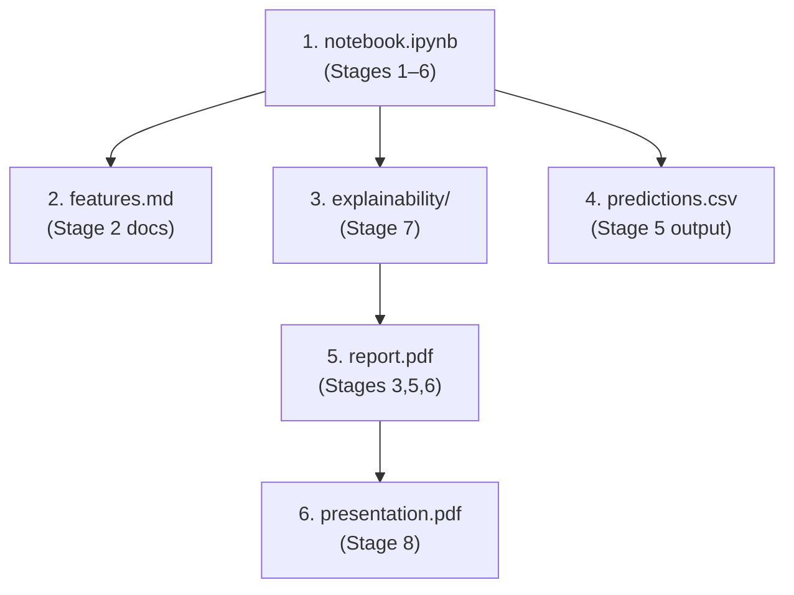

# FictiPay Datathon — Complete Workload Plan

> **Competition**: bKash presents NSUCEC Datathon  
> **Problem**: Binary classification — predict Customer churn (CHURN = 1 if zero outbound transactions in April 2024)  
> **Metric**: AUC-ROC  
> **Total Points**: 100 (across 8 stages)

---

## 1. Data Inventory

All raw data lives under `bkash-presents-nsucec-datathon/public/`.

| File | Size | Rows (approx) | Notes |
|---|---|---|---|
| `kyc.parquet` | ~7 MB | ~2M | All account types (Customer / Merchant / Biller) |
| `transactions/trx_2024-01.parquet` | ~555 MB | — | January transactions |
| `transactions/trx_2024-02.parquet` | ~512 MB | — | February transactions |
| `transactions/trx_2024-03.parquet` | ~536 MB | — | March transactions |
| `dayend_balance/balance_2024-01.parquet` | ~133 MB | — | January daily balances |
| `dayend_balance/balance_2024-02.parquet` | ~104 MB | — | February daily balances |
| `dayend_balance/balance_2024-03.parquet` | ~100 MB | — | March daily balances |
| `train_labels.csv` | ~9 MB | 595,000 | ACCOUNT_ID + CHURN label |
| `test.csv` | ~3.3 MB | 255,000 | ACCOUNT_ID only (predict these) |
| `sample_submission.csv` | ~4.3 MB | 255,000 | Expected output format |

**Total raw data**: ~1.6 GB on disk; ~200M transaction rows + ~360M balance rows.

### Already Produced

| File | Location | Status |
|---|---|---|
| [predictions_tuned.csv](file:///c:/Users/Sowmik/Documents/GitHub/Personal%20AI%20assistant%20folder/cybernauts-datathon/predictions_tuned.csv) | repo root | ✅ 255,000 rows with `ACCOUNT_ID,CHURN_PROB` — appears to be a valid submission |

---

## 2. Key Documents & Guidelines

| Document | Location | Purpose |
|---|---|---|
| [DATATHON_GUIDE.md](file:///c:/Users/Sowmik/Documents/GitHub/Personal%20AI%20assistant%20folder/cybernauts-datathon/DATATHON_GUIDE.md) | repo root | Master playbook — scoring rubric, feature library, code blueprint, submission checklist |
| [README.md](file:///c:/Users/Sowmik/Documents/GitHub/Personal%20AI%20assistant%20folder/cybernauts-datathon/bkash-presents-nsucec-datathon/public/README.md) | `public/` | Dataset description — schemas, label distribution, churn definition, submission format |

---

## 3. The 8 Evaluative Stages — Task Breakdown

### Stage 1: Large-Scale Data Handling — 10 pts *(Human Evaluated)*

| # | Task | Details |
|---|---|---|
| 1.1 | Choose processing stack | Guide recommends **Polars LazyFrames** or **PySpark**; README suggests Dask/PySpark |
| 1.2 | Implement lazy/streaming parquet ingestion | `scan_parquet()` with glob patterns for monthly partitions |
| 1.3 | Demonstrate out-of-core processing | Never materialise full 200M+ rows; only collect aggregated feature tables |
| 1.4 | Document partitioning strategy in notebook | Show date-based partitioning and streaming collection |

> [!IMPORTANT]
> Evaluators want to see *evidence* of out-of-core strategy in your notebook — not just that it works, but that you explain **why** you chose this approach over pandas.

---

### Stage 2: Feature Engineering — 15 pts *(Human Evaluated)*

The guide prescribes **10 specific features** with formulas. All must be implemented and documented.

| Feature | Name | Source Table | Category |
|---|---|---|---|
| F1 | Days Since Last Outbound Activity | Transactions | Recency |
| F2 | March Activity Momentum Ratio | Transactions | Velocity |
| F3 | Outbound Volume Concentration Trend | Transactions | Monetary |
| F4 | Balance Depletion Rate | DayEndBalance | Trend |
| F5 | Balance Volatility Index | DayEndBalance | Dispersion |
| F6 | Platform Pass-Through Index | Transactions | Behavioral |
| F7 | Digital Ecosystem Interdependence | Transactions | Utility |
| F8 | Vintage Account Factor | KYC | Profile |
| F9 | Absolute Balance Level (Mar 31) | DayEndBalance | Liquidity |
| F10 | Inbound Support Frequency | Transactions | Network |

| # | Task | Details |
|---|---|---|
| 2.1 | Implement all 10 features using the exact formulas from the guide | See Section 5 of [DATATHON_GUIDE.md](file:///c:/Users/Sowmik/Documents/GitHub/Personal%20AI%20assistant%20folder/cybernauts-datathon/DATATHON_GUIDE.md) |
| 2.2 | Write `features.md` with business rationales for each feature | Required deliverable |
| 2.3 | Optionally add creative features beyond the 10 | Could boost score; not strictly required |

> [!NOTE]
> The guide's code blueprint already implements F1–F9 but **misses F10 (Inbound Support Frequency)** — the DST_ACCOUNT-based inbound count. Make sure to add it.

---

### Stage 3: Feature Quality & Pareto Analysis — 10 pts *(Human Evaluated)*

| # | Task | Details |
|---|---|---|
| 3.1 | Identify dormant users | Create binary `is_dormant_last_30d` indicator |
| 3.2 | Analyse skewness | Plot transaction volume distributions |
| 3.3 | Apply log-transforms | `log(x + 1)` or Box-Cox / Yeo-Johnson on skewed features |
| 3.4 | Winsorize outliers | Cap at 99th percentile |
| 3.5 | Document transformations in notebook | Show before/after distributions |

---

### Stage 4: Class Imbalance & Sampling — 10 pts *(Human Evaluated)*

| # | Task | Details |
|---|---|---|
| 4.1 | Calculate imbalance ratio | 519,565 / 75,435 ≈ 6.88 |
| 4.2 | Use `scale_pos_weight` in LightGBM/XGBoost | Set to ~6.88; avoid SMOTE |
| 4.3 | Justify approach in notebook | Explain why cost-sensitive learning > synthetic oversampling for large tabular data |

---

### Stage 5: Model Selection & Training — 20 pts *(Auto Evaluated ★)*

> [!CAUTION]
> This is the **only auto-evaluated stage** — your AUC-ROC on the private test set directly determines points. This is the highest-stakes stage.

| # | Task | Details |
|---|---|---|
| 5.1 | Train LightGBM with 5-fold Stratified CV | Primary model; blueprint provided in guide |
| 5.2 | Train XGBoost as secondary learner | Compare performance |
| 5.3 | (Optional) Train CatBoost | Leave categoricals unencoded for native handling |
| 5.4 | Report CV metrics | AUC-ROC, PR-AUC, Precision@10%, Recall@10% |
| 5.5 | Generate `predictions.csv` | 255,000 rows, `ACCOUNT_ID,CHURN_PROB`, floats in [0, 1] |

---

### Stage 6: Hyperparameter Tuning — 10 pts *(Human Evaluated)*

| # | Task | Details |
|---|---|---|
| 6.1 | Set up Optuna with TPE sampler | Bayesian optimisation |
| 6.2 | Define search space | `learning_rate` [0.01, 0.1], `num_leaves` [31, 127], `min_child_samples` [20, 200], `feature_fraction` [0.6, 0.9], `reg_alpha`/`reg_lambda` |
| 6.3 | Run optimisation trials | Track best trial metrics |
| 6.4 | Plot Optuna history | Save optimisation charts for `report.pdf` |
| 6.5 | Retrain final model with best params | Generate final predictions |

---

### Stage 7: Model Explainability — 15 pts *(Human Evaluated)*

| # | Task | Details |
|---|---|---|
| 7.1 | Compute SHAP values | Use `shap.TreeExplainer` on best model |
| 7.2 | Generate beeswarm plot | Save to `explainability/` directory |
| 7.3 | Generate dependence plots | For top features |
| 7.4 | Write interpretations | Feature importance narrative |
| 7.5 | Verify no data leakage | Confirm no April 2024 data or target labels in feature matrix |

> [!WARNING]
> **Leakage Safeguard**: Ensure no post-observation-window data (April 2024) or CHURN labels leak into feature engineering. This is explicitly called out as an evaluation criterion.

---

### Stage 8: Business Recommendations — 10 pts *(Human Evaluated)*

| # | Task | Details |
|---|---|---|
| 8.1 | Segment high-risk customers | Top 5–10% by predicted CHURN_PROB |
| 8.2 | Design retention strategy | Risk-based targeting with incentives (cashback, offers) |
| 8.3 | Estimate financial lift | Calculate cost savings from prevented churn vs. retention costs |
| 8.4 | Create `presentation.pdf` | 5-slide deck or dashboard mockup for leadership |

---

## 4. Required Submission Artifacts Checklist

| # | Artifact | Format | Status | Priority |
|---|---|---|---|---|
| 1 | `predictions.csv` | CSV (255,000 rows: `ACCOUNT_ID,CHURN_PROB`) | ⚠️ `predictions_tuned.csv` exists — rename or regenerate | 🔴 Critical |
| 2 | `features.md` | Markdown or PDF | ❌ Not started | 🔴 Critical |
| 3 | `notebook.ipynb` | Jupyter Notebook (fully commented, reproducible) | ❌ Not started | 🔴 Critical |
| 4 | `report.pdf` | PDF (metrics tables, Optuna charts) | ❌ Not started | 🔴 Critical |
| 5 | `explainability/` | Directory with SHAP plots + interpretations | ❌ Not started | 🔴 Critical |
| 6 | `presentation.pdf` | PDF / PPTX (5-slide deck) | ❌ Not started | 🟡 High |

---

## 5. Suggested Execution Order

| Step | What to do | Covers Stages | Est. Effort |
|---|---|---|---|
| 1 | Build the end-to-end notebook (ingestion → features → transforms → training → tuning → prediction) | 1, 2, 3, 4, 5, 6 | Heavy |
| 2 | Write `features.md` documenting all 10+ features with business rationales | 2 | Medium |
| 3 | Generate SHAP plots and save to `explainability/` folder | 7 | Medium |
| 4 | Finalise and rename predictions to `predictions.csv` | 5 | Light |
| 5 | Compile `report.pdf` — performance metrics, distribution plots, Optuna charts | 3, 5, 6 | Medium |
| 6 | Create 5-slide `presentation.pdf` with business strategy | 8 | Medium |

---

## 6. Points Breakdown Summary

| Stage | Points | Evaluation | Focus |
|---|---|---|---|
| 1 — Data Handling | 10 | Human | Show out-of-core processing |
| 2 — Feature Engineering | 15 | Human | 10 features + rationales |
| 3 — Feature Quality | 10 | Human | Skewness, outliers, transforms |
| 4 — Class Imbalance | 10 | Human | Cost-sensitive learning |
| 5 — Model Training | 20 | **Auto** | AUC-ROC score |
| 6 — Hyperparameter Tuning | 10 | Human | Optuna / Bayesian |
| 7 — Explainability | 15 | Human | SHAP plots |
| 8 — Business Strategy | 10 | Human | Retention recommendations |
| **Total** | **100** | | |

> [!TIP]
> **80 of 100 points are human-evaluated** — quality of documentation, plots, business reasoning, and notebook clarity matter as much as model performance. Invest significant time in write-up quality.

---

## 7. Technical Constraints & Gotchas

| Constraint | Detail |
|---|---|
| **Memory** | ~1.6 GB parquet data; must use Polars LazyFrame / PySpark / Dask — not pandas |
| **Observation window** | Jan 1 – Mar 31, 2024 **only**; no April data available |
| **Leakage risk** | Never use CHURN labels or April data in features |
| **Class imbalance** | 12.7% churn; use `scale_pos_weight ≈ 6.88` |
| **F10 missing from blueprint** | The guide's code blueprint implements F1–F9 but skips F10 (Inbound Support Frequency); must be added manually |
| **Predictions format** | Header must be `ACCOUNT_ID,CHURN_PROB`; exactly 255,000 rows; floats in [0, 1] |
| **Existing `predictions_tuned.csv`** | Has 255,000 rows and looks valid; decide whether to use as-is or regenerate |
